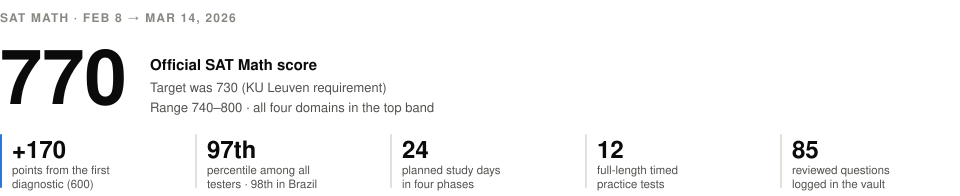
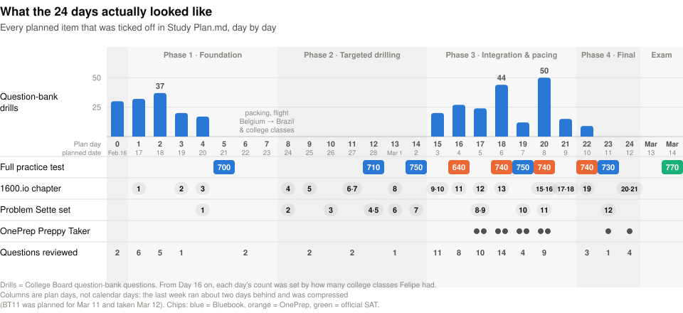
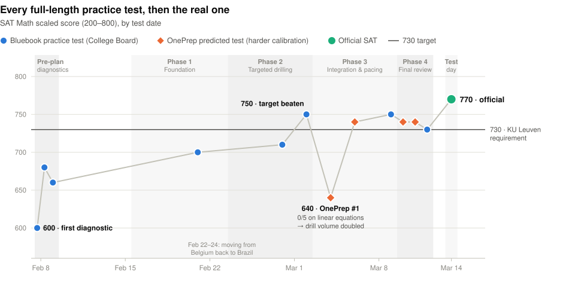
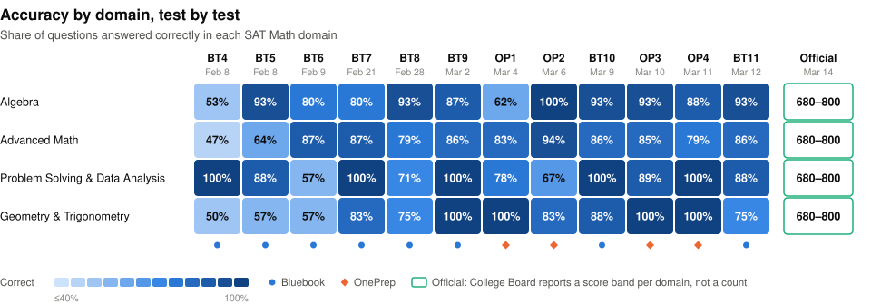

<picture>
  <source media="(prefers-color-scheme: dark)" srcset=".github/readme/hero-dark.svg">
  
</picture>

# SAT Math Prep · 600 → 770

This is the Obsidian vault I used to prepare for the SAT Math section between February 8 and March 14, 2026. It holds the day-by-day study plan, every practice test, my topic notes and the 85 questions I reviewed along the way.

The repository *is* the vault. Clone it and open the folder in Obsidian to see it the way I used it, with the same theme, plugins and dashboard ([how](#open-it-in-obsidian)).

**Contents:** [Why the SAT](#why-the-sat) · [How the plan was made](#how-the-plan-was-made) · [How a day worked](#how-a-day-worked) · [The evolution](#the-evolution) · [Test day](#test-day) · [What's inside](#whats-inside) · [Open it in Obsidian](#open-it-in-obsidian)

---

## Why the SAT

In early 2026 I had finished two years of Electrical Engineering at EESC-USP in São Carlos, Brazil, and I was applying to KU Leuven's **Bachelor of Engineering Technology**, the English-taught programme at the Group T campus in Leuven, Belgium.

Applicants from outside the EU have to prove their maths level with one of three tests: **SAT Math ≥ 730**, ACT Math ≥ 32, or SOWISO's OMPT-D at ≥ 60%. I went with the SAT, so 730 became the target. As I put it at the time, this test was practically my passport to Leuven.

Only the Math section counted, so the prep was Math only. (Reading and Writing was taken without any preparation.) I sat the exam on **March 14, 2026 in São Paulo**, scored **770 in Math**, was admitted, and started at KU Leuven on August 30, 2026.

## How the plan was made

**1. Diagnose first.** On February 8 and 9 I took three official Bluebook practice tests (600, 680, 660). They showed where the points were:

- Geometry & Trigonometry was the weakest domain, at 50–57%.
- Advanced Math swung from 47% to 87%.
- Problem Solving & Data Analysis dropped from 100% to 57%.
- Algebra was already solid after the first test.

**2. Build the plan with Claude.** I designed the plan with [Claude](https://claude.ai), Anthropic's AI assistant, inside a dedicated Claude project. Claude had read and write access to this vault through a filesystem connector, so the plan never lived in a chat message. It lived in [`Study Plan.md`](Study%20Plan.md), which Claude read at the start of every session and edited as things changed. The conventions were agreed along the way and kept in the project's instructions and memory: the template for each day, the callout system for reviewed questions, and the current priorities. The work ran over several chats: *SAT PREP #1*, *#2*, *#3* and *SAT FINAL PREP*.

The result was a fixed calendar: a warm-up day, 24 study days in four phases, a light review day and the exam.

| Phase | Plan days | Planned dates | Goal | Checkpoint tests |
|---|---|---|---|---|
| Warm-up | Day 0 | Feb&nbsp;16 | Easy and medium questions in all four domains | |
| **1 · Foundation** | Days 1–7 | Feb 17–23 | Build Geometry & Trig from scratch, find the weak PSDA skills, keep Algebra and Advanced Math warm | BT7 · 700 |
| **2 · Targeted drilling** | Days 8–14 | Feb 24 – Mar 2 | Module 2 patterns in Algebra and Advanced Math, start Desmos, stop the careless mistakes | BT8 · 710, BT9 · **750** |
| **3 · Integration & pacing** | Days 15–21 | Mar 3–9 | Hard mixed practice under time; after OP1, an "emergency" drilling block | OP1 · 640, OP2 · 740, BT10 · 750 |
| **4 · Final review** | Days 22–24 | Mar 10–12 | No new content: consolidate, Desmos, confidence | OP3 · 740, OP4 · 740, BT11 · 730 |
| Light review | | Mar&nbsp;13 | Vault review and light practice until mid-afternoon, then rest | |
| **Exam** | | Mar&nbsp;14 | São Paulo | **Official · 770** |

*BT = Bluebook practice test (College Board's official app). OP = OnePrep predicted test, calibrated to recent real exams and harder than Bluebook.*

Every day had a **Focus** line and a checklist built from the same ingredients:

- **Question-bank drills**, by domain and skill, from the College Board [SAT Suite Question Bank](https://satsuitequestionbank.collegeboard.org/) and [OnePrep](https://www.oneprep.xyz/home).
- **A chapter of the [1600.io](https://1600.io/) SAT Math Orange Book.**
- **A Tutorllini *Problem Sette* set** of hard problems.
- **A video** or two (the [Homepage](Homepage.md) keeps the whole library).
- **A full, timed practice test** on checkpoint days.

**3. Re-plan after every test.** The plan was never frozen. These were the big turns:

- **BT7 · 700 (Feb 21).** 4 of the 6 misses were careless. New rule for every test: re-read the question, watch for *NOT / least / greatest*, check signs.
- **BT8 · 710 (Feb 28).** The same sign errors again (−29/3 vs 29/3, 34 vs −34). I added a three-step check before submitting and switched to a Casio fx-991CW, with [its own practice note](Calculator%20Practice%20%E2%80%94%20FX-991CW.md).
- **BT9 · 750 (Mar 2).** Target beaten, zero sign errors, and a perfect Module 1 for the third test in a row.
- **OP1 · 640 (Mar 4).** OnePrep's harder calibration exposed a blind spot: **0/5 on linear equations in one variable**. The rest of the plan became an emergency plan. Daily drill blocks were doubled or more (110 → 245 planned questions over Days 16–24), linear equations came up every day until the exam, the daily count was set by how many college classes I had that day, and every SAT Math skill had to be practised at least once.
- **The question bank ran dry** for one skill (inference from sample statistics), so Claude wrote fresh SAT-style questions for those slots, with answers hidden in collapsed callouts.
- **The last week slipped about two days behind the calendar.** The final days were compressed, BT11 was protected, and March 13 changed from a full rest day to a light review day.

## How a day worked

1. **Open today's block** in [`Study Plan.md`](Study%20Plan.md). Claude did the same at the start of each chat.
2. **Work the checklist** (drills, book chapter, problem set) and tick the boxes.
3. **Every miss or insight goes to Claude**, usually as a screenshot. Claude works out what kind of mistake it was (a concept gap, a misread, an algebra slip, rushing), solves it, and pulls out a rule. Then it goes into that day's *Questions to review* as a callout. The outer callout holds the question and the trap. A nested, collapsed callout holds the answer and the full solution, so re-reading it later is a real retry. Answers start with **→** instead of a dash, so they can't be misread as a minus sign.
4. **On test days:** a full timed test, then a score note from the [template](Templates/Score%20Entry.md) in [`Scores/`](Scores), a row in the [Score Log](Scores/Score%20Log.md), and the Homepage charts update on their own (Dataview reads each note's frontmatter).
5. **Re-plan** tomorrow around what happened today.

All of this happened around college classes, with a move in the middle: I packed in Belgium on February 22, flew back to Brazil on the 23rd and studied around my USP classes from then on.

<picture>
  <source media="(prefers-color-scheme: dark)" srcset=".github/readme/daily-workload-dark.svg">
  
</picture>

In total that came to **337** question-bank drills, **12** full-length practice tests, **10** shorter OnePrep "Preppy Taker" practices, **20** of the 21 Orange Book chapters, all **12** Problem Sette sets and **85** reviewed questions, plus 30 exercises Claude wrote for the book's last chapter. For chapters 18–20, where time was short, Claude picked the 13 most test-relevant exercises of each.

## The evolution

<picture>
  <source media="(prefers-color-scheme: dark)" srcset=".github/readme/score-trajectory-dark.svg">
  
</picture>

- **+170 points** from the first diagnostic (600) to the exam (770), in five weeks.
- **From BT9 on, 6 of 7 practice tests scored 730 or more.** The exception is OP1, the one that triggered the emergency plan.
- **The official 770 beat every full-length practice score**; the best before it was 750.

<picture>
  <source media="(prefers-color-scheme: dark)" srcset=".github/readme/domain-heatmap-dark.svg">
  
</picture>

- **Advanced Math** went from 47% on the first test to 79–94% on every test from BT6 on.
- **Geometry & Trigonometry**, the weakest domain at the start (50–57%), hit 100% on 4 of the last 7 tests.
- **Algebra** stayed at 80% or more after the first test, except for OP1's 62%.
- **Problem Solving & Data Analysis** never settled (57–100%), and most of its misses were unit or careless slips, like answering 60000 instead of 6 on BT11.
- **On the real test, all four domains landed in the top band (680–800).**

<b>Every score, as a table</b>

| # | Date | Test | Math | Correct | Algebra | Advanced Math | PSDA | Geometry & Trig |
|---|---|---|---|---|---|---|---|---|
| 1 | Feb&nbsp;8 | Bluebook Test 4 | 600 | 26/44 | 8/15 | 7/15 | 8/8 | 3/6 |
| 2 | Feb&nbsp;8 | Bluebook Test 5 | 680 | 34/44 | 14/15 | 9/14 | 7/8 | 4/7 |
| 3 | Feb&nbsp;9 | Bluebook Test 6 | 660 | 33/44 | 12/15 | 13/15 | 4/7 | 4/7 |
| 4 | Feb&nbsp;21 | Bluebook Test 7 | 700 | 38/44 | 12/15 | 13/15 | 8/8 | 5/6 |
| 5 | Feb&nbsp;28 | Bluebook Test 8 | 710 | 36/44 | 14/15 | 11/14 | 5/7 | 6/8 |
| 6 | Mar&nbsp;2 | Bluebook Test 9 | 750 | 40/44 | 13/15 | 12/14 | 8/8 | 7/7 |
| 7 | Mar&nbsp;4 | OnePrep #1 | 640 | 34/44 | 10/16 | 10/12 | 7/9 | 6/6 |
| 8 | Mar&nbsp;6 | OnePrep #2 | 740 | 40/44 | 12/12 | 16/17 | 4/6 | 5/6 |
| 9 | Mar&nbsp;9 | Bluebook Test 10 | 750 | 40/44 | 14/15 | 12/14 | 7/7 | 7/8 |
| 10 | Mar&nbsp;10 | OnePrep #3 | 740 | 40/44 | 14/15 | 11/13 | 8/9 | 6/6 |
| 11 | Mar&nbsp;11 | OnePrep #4 | 740 | 40/44 | 7/8 | 11/14 | 11/11 | 11/11 |
| 12 | Mar&nbsp;12 | Bluebook Test 11 | 730 | 38/44 | 13/14 | 12/14 | 7/8 | 6/8 |
| 🏆 | **Mar&nbsp;14** | **Official SAT** | **770** | | 680–800 | 680–800 | 680–800 | 680–800 |

OnePrep's domain breakdowns are copied as reported and don't always add up to 44. For the official test, College Board reports a score band per domain instead of a count. Official percentiles: 97th among all testers, 98th in Brazil.

OnePrep "Preppy Taker" practices, Mar 5–12 (planned days): 760 · 740 · 770 · 780 · 760 · 790 · 710 · 720 · 720 · 720. Practices 1–6 were routed to an easy second module, so their scores aren't comparable with the full tests above. Practices 7–10 went to the hard module.

## Test day

What worked on March 14, as written down after the exam:

- **Skip and return.** Hard questions were skipped on the first pass and solved at the end.
- **Scratch paper for every sign**, because sign errors were the recurring practice-test leak.
- **Desmos for anything visual or messy**: regressions, intersections, parameter sliders (see [Desmos Practice](Desmos%20Practice.md) and [Advanced Desmos Techniques](Advanced%20Desmos%20Techniques%20for%20SAT%20Math%20800.md)).
- **Guess what's left.** The last two multiple-choice questions were guessed, since wrong answers cost nothing.

Full result: [`Scores/Official SAT — March 2026`](Scores/Official%20SAT%20%E2%80%94%20March%202026.md).

## What's inside

| Path | What it is |
|---|---|
| [`Homepage.md`](Homepage.md) | The dashboard: result, score charts, domain radar, analysis, resources and the video library. Start here. |
| [`Study Plan.md`](Study%20Plan.md) | The plan itself, about 3,900 lines: every day's checklist and results, and the 85 review callouts. |
| [`Scores/`](Scores) | One note per practice test (its frontmatter feeds the charts), the Score Log and the official result. |
| `01 - Algebra/` … `04 - Geometry and Trigonometry/` | Topic notes per domain: linear equations and systems, quadratics, the discriminant, exponentials, ratios and probability, circles, similar triangles. |
| [`Desmos Practice.md`](Desmos%20Practice.md), [`Advanced Desmos Techniques…`](Advanced%20Desmos%20Techniques%20for%20SAT%20Math%20800.md) | Desmos from the basics to the regression tricks that solve "find the coefficients" questions in a few lines. |
| [`Calculator Practice — FX-991CW.md`](Calculator%20Practice%20%E2%80%94%20FX-991CW.md) | Casio fx-991CW reference plus hard Module-2-style questions, each tagged with the fastest calculator feature. |
| [`Rounding Reference.md`](Rounding%20Reference.md) | Rounding rules for grid-in answers. |
| [`Templates/`](Templates) | Templates for score notes, test analysis and topic notes. |
| [`Extra exercises/`](Extra%20exercises) | 60 medium questions exported from the SAT Suite Question Bank. |
| `media/` | Screenshots, diagrams and short videos used by the notes. |
| `.obsidian/` | Theme, plugins and settings, so the vault looks the same on your machine. |

## Open it in Obsidian

1. Download the repository (**Code → Download ZIP**, then unzip) or `git clone` it.
2. In [Obsidian](https://obsidian.md), choose **Open folder as vault** and pick the folder.
3. When Obsidian asks, **trust the author and turn on community plugins**. Without them the charts, Dataview tables and the Homepage banner won't render.
4. Open **Homepage**.

The notes can also be read here on GitHub, but they're written for Obsidian: callouts, `[[links]]`, charts and Dataview queries only work there.

<b>Theme and plugins</b>

Theme: **Minimal** (light mode, accent `#16b0fe`) with Minimal Theme Settings and Style Settings.

| Plugin | Used for |
|---|---|
| Dataview | Homepage charts and tables built from the score notes' frontmatter |
| Charts | Score progression and domain charts |
| Pixel Banner | The banner and SAT logo on the Homepage |
| Latex Suite, TikZJax | Math typing and drawn figures |
| Callout Manager, Highlightr, Colored Tags Wrangler, Editing Toolbar | Callout colours, highlights and editing comfort |
| Image Converter | Handling the pasted screenshots |
| Kanban, Advanced Canvas, Canvas Mindmap | Installed, not central to this vault |

## Notes

- Kept out of this copy: the College Board score report PDF, which carries personal identifiers, and Obsidian's per-device `workspace.json`.
- The question screenshots and the PDF in `Extra exercises/` come from College Board's free SAT Suite Question Bank (© College Board). The 1600.io book and Tutorllini's sets are referenced, not included.
- The README charts are generated from the vault's own data by [`.github/readme/build_charts.py`](.github/readme/build_charts.py): scores from the frontmatter in `Scores/`, the daily workload from the ticked boxes in `Study Plan.md`.

The plan, the reviews and this write-up were made with Claude. The studying was mine.
